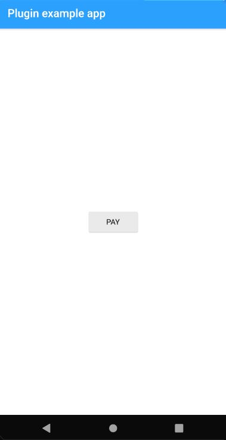
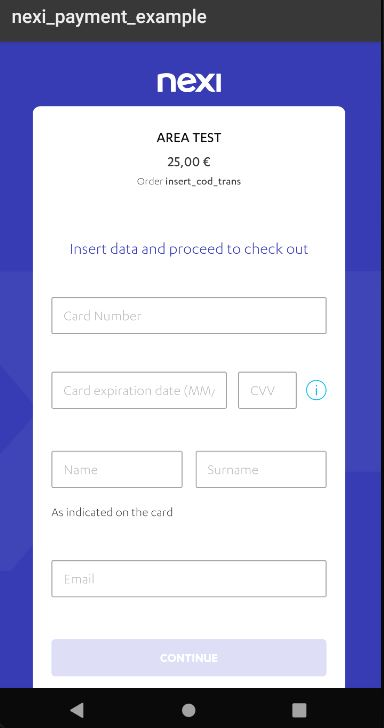
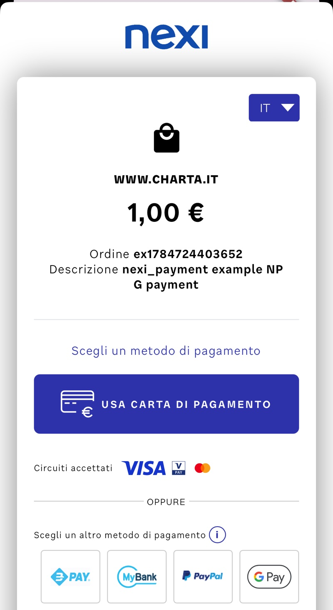
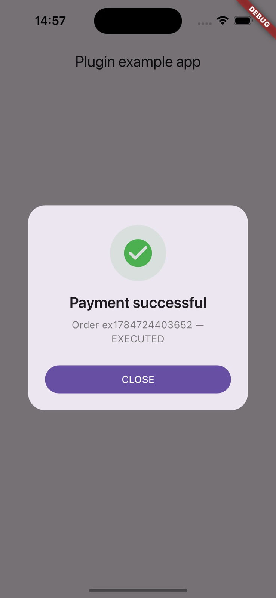

# nexi_payment

[](https://github.com/PaoloGi/nexi_payment/actions/workflows/ci.yml)

Flutter plugin for Nexi payment integration, supporting both Nexi gateways:

- **Classic XPay** (ecommerce.nexi.it) — WebView payment via `NexiPayment`
- **NPG** (developer.nexigroup.com) — Nexi's newer gateway; Hosted Payment Page
  via `NexiNpgPayment`

**New here?** [INTEGRATION.md](INTEGRATION.md) walks through getting
credentials, wiring up either gateway and going live, step by step.

## Requirements

- Dart >= 3.3, Flutter >= 3.16
- Android: minSdk 23, a consumer app built with AGP 8+
- iOS: deployment target 14.4 (`platform :ios, '14.4'` in your Podfile)

No manual SDK setup is needed. On iOS the Nexi SDKs (XPaySDK 1.5.1 with its
ThreeDS_SDK dependency, and NPGSDK 1.1.0) are downloaded from Nexi's own
release repositories during `pod install` and verified against pinned SHA-256
checksums — see `ios/scripts/fetch_frameworks.sh`. Building therefore needs
network access the first time, and the frameworks land in `ios/Frameworks/`,
which is not tracked in git.

On Android the SDKs ship as small `.aar` files in `android/libs/`, since Nexi
publishes no Maven artifacts for them.

## Installation

```sh
flutter pub add nexi_payment
```

Then import the gateway you need:

```dart
import 'package:nexi_payment/nexi_payment.dart';      // classic XPay
import 'package:nexi_payment/nexi_payment_npg.dart';  // NPG Hosted Payment Page
```

The first import also re-exports `EnvironmentUtils` and `CurrencyUtilsQP`, so a
single import is enough for the classic gateway.

## Classic XPay gateway

Initialize `NexiPayment` with your secretKey and environment (test or prod):

```dart
@override
void initState() {
  super.initState();
  _nexiPayment = NexiPayment(secretKey: "_yourSecretKey_", environment: EnvironmentUtils.TEST);
}
```

> **Leave `domain` unset unless you really need a custom host.** The
> environment already picks the right one (TEST →
> `https://int-ecommerce.nexi.it`, PROD → `https://ecommerce.nexi.it`), and a
> non-empty `domain` *overrides* it — passing the production URL together
> with `EnvironmentUtils.TEST` sends the test terminal's requests to
> production, which Nexi rejects with a generic error page in the checkout.

To start the payment process just call `xPayFrontOfficePaga`:

```dart
try {
  // codTrans must be unique per attempt — Nexi rejects a reused one with a
  // generic "operation failed" page in the checkout.
  var res = await _nexiPayment.xPayFrontOfficePaga("YOUR_ALIAS", codTrans, CurrencyUtilsQP.EUR, amount);
  if (res == NexiPayment.canceledByUser) {
    // user cancelled
  } else {
    // res == "OK"
  }
} on PlatformException catch (e) {
  // e.code is one of the codes below
}
```

`res` is `"OK"` on success or `NexiPayment.canceledByUser` (the string
`"Operation canceled by the user"`, exposed as a constant so you don't have to
hardcode it) when the user cancels — this is now the same string on both
platforms. Everything else throws a `PlatformException` with one of these
codes:

| Code | Platform | Meaning |
|---|---|---|
| `AUTH_DENIED` | both | The payment authorization was denied |
| `IN_PROGRESS` | both | A classic payment is already running |
| `INVALID_REQUEST` | both | Missing/invalid payment parameters, or a non-EUR currency on iOS |
| `NOT_INITIALIZED` | both | `initXPay` did not complete before paying |
| `NO_ACTIVITY` | both | Plugin not attached to an Activity / no root view controller |
| `DEVICE_ROOTED` | Android | The SDK refuses to run on a rooted device |
| `DEVICE_JAILBROKEN` | iOS | The SDK refuses to run on a jailbroken device |
| `INIT_FAILED` | iOS | `initXPay` failed for a reason other than jailbreak detection |
| `ACTIVITY_DESTROYED` | Android | The host Activity/engine was torn down for good mid-payment (not raised on a rotation/config change) |

On Android, lower-level SDK failures may additionally surface through the native
SDK's own `onError` callback, carrying the SDK's own error code — so treat the
table above as the common cases, not a closed set.

`xPayFrontOfficePaga` always completes, whichever way the user leaves the
checkout. That takes a little help from the plugin on Android: XPaySDK
finishes its WebView Activity on the system **back button** without invoking
its own callback, so the plugin watches the checkout's lifecycle and resolves
with `NexiPayment.canceledByUser` when it disappears having said nothing —
the same result the cancel link on Nexi's payment page produces. A real
outcome always wins; the fallback only fills the SDK's silence.

> As always, the client result tells you what the user saw. Treat your
> server-side notification as the source of truth for whether an order is
> paid.





### Storing a card and charging it later

Pass XPay's contract parameters on a normal payment and Nexi keeps the card,
so later charges need no card entry and no checkout:

```dart
// 1. First payment — the customer enters the card once, in Nexi's checkout.
await nexi.xPayFrontOfficePaga(
  alias, codTrans, CurrencyUtilsQP.EUR, 2500,
  extraParameters: {
    'num_contratto': 'customer-42-card-1',   // an id you choose — see below
    'tipo_servizio': 'paga_multi',           // store the card
  },
);

// 2. Any later charge — no UI, no customer present.
final result = await nexi.xPayRecurringPayment(
  alias: alias,
  contractId: 'customer-42-card-1',
  codTrans: nextUniqueCodTrans,
  amount: 999,
);
if (result.isSuccess) { /* result.authCode */ }
else { /* result.errorCode, result.errorMessage */ }
```

A refusal is a normal result with `isSuccess == false` carrying XPay's
`errorCode` and `errorMessage`, not an exception; only configuration problems
throw.

> **`num_contratto` must be new every time you store a card.** XPay refuses one
> that already exists, and it refuses it badly: the checkout dead-ends on an
> "operazione non andata a buon fine" page that the back button cannot leave,
> so the payment neither completes nor cancels and the user has to kill the
> app. Generate a fresh id per stored card — one per customer, or per card —
> and persist it. Reusing the id is for *charging* (step 2), never for storing.

`extraParameters` is passed to the checkout untouched, so it also carries
anything else XPay accepts — `urlpost` for your server-to-server notification,
`mail`, `descrizione` — without the plugin needing to model each one.

> **Think about where step 2 runs.** It moves money with no user present, so
> an app that calls it must carry your `secretKey` — and anyone who unpacks
> that app can then charge every card you have stored. If you have a backend,
> make recurring charges there and keep the key off the device. Use
> `xPayRecurringPayment` when the app genuinely is the whole product and you
> accept that trade-off knowingly.

## NPG gateway (Hosted Payment Page)

For merchants on the new Nexi gateway (developer.nexigroup.com). Import the
opt-in library:

```dart
import 'package:nexi_payment/nexi_payment_npg.dart';
```

Open the Hosted Payment Page and await the typed result:

```dart
final npg = NexiNpgPayment(hostname: hostname, apiKey: apiKey);
final result = await npg.payWithHostedPaymentPage(NpgHostedPaymentRequest(
  orderId: "your-order-id",
  amount: 2500, // minor units: €25.00
  currency: "EUR",
  language: "ita",
));
switch (result.status) {
  case NpgPaymentStatus.success:
    // result.operationResult e.g. "EXECUTED" or "AUTHORIZED"
    break;
  case NpgPaymentStatus.canceled:
    break;
  case NpgPaymentStatus.error:
    // result.errorCode / result.errorMessage
    break;
}
```

> **Security note (from Nexi's guidelines):** the NPG `hostname` and `apiKey`
> identify your merchant and should be retrieved at runtime from your backend,
> not hardcoded in the app.

`NpgPaymentStatus.success` means the payment went through — the plugin reports
it only for a final `AUTHORIZED` or `EXECUTED` operation. That is a stricter
rule than the native SDKs apply: they call their "completed" callback for a
payment that merely *finished*, so a declined card or a failed 3DS would
otherwise look like a success. Those arrive as `NpgPaymentStatus.error` with
the NPG operation result as `errorCode` (`THREEDS_FAILED`, `DECLINED`,
`DENIED_BY_RISK`, …), and `operationResult` always carries the raw value.

### The SDK's parsing defect, and how the plugin works around it

NPGSDK 1.1.0 (the latest Nexi ships) declares `operations[].additionalData` as
`Map<String, String>`, but the NPG backend nests an object inside it —
`originalTraceId` — which that type cannot hold. So after a completed card
payment the Android SDK can fail to parse the outcome **even though the payment
was executed and captured**. Left alone, a successful payment looks like a
failure.

The plugin handles this for you: when the SDK cannot parse the outcome, it reads
the order back from the NPG orders API (the same `hostname` and `apiKey` it used
to create it) and reports the real result. A payment that went through comes
back as `NpgPaymentStatus.success` with its true `operationResult`.

Recovery never invents a success — it only reports one for a final `AUTHORIZED`
or `EXECUTED` operation. A genuine decline comes back as an error carrying the
NPG operation result (e.g. `DECLINED`), and anything else — a non-final state,
or an orders API that is unreachable or unhappy — leaves the original
`errorCode: RESULT_PARSING_FAILED` untouched, which still means "outcome
unknown, verify server-side", never "declined":

```dart
if (result.errorCode == NpgPaymentResult.resultParsingFailedCode) {
  // The payment may well have succeeded — confirm the order server-side
  // (your notificationUrl, or the orders API) before failing the purchase.
}
```

Turn the whole thing off with `NexiNpgPayment(..., recoverOutcomeOnParsingFailure: false)`
if your app must not call the NPG API directly — for instance because your
backend already reconciles every order.

iOS parses the same payment cleanly, so this only bites on Android today; the
guard is wired on both platforms in case Nexi's iOS SDK ever regresses.





## Testing

See [TESTING.md](TESTING.md) for the unit tests, the Patrol integration tests
that drive the real native SDKs, and the manual checklist with Nexi's sandbox
credentials and test cards.

## Credentials

The two gateways use different, non-interchangeable credentials:

- **Classic XPay** — alias and "chiave per il calcolo mac" from the Nexi
  merchant portal (test area: https://ecommerce.nexi.it/area-test).
- **NPG** — a bare hostname and a UUID X-Api-Key from the NPG back office
  (https://developer.nexigroup.com).

[INTEGRATION.md](INTEGRATION.md) explains where each value comes from and
where it goes.

## Migrating from 1.x to 2.0.0

The classic API is source-compatible: the `NexiPayment` constructor and
`xPayFrontOfficePaga` signature are unchanged, and a successful payment still
resolves with `"OK"`. The error and cancel *contract* did change on iOS,
though — see below. What changed:

- **iOS now matches Android's error/cancel contract.** Previously iOS resolved
  the future successfully even for a denied payment or an init failure
  (reporting them as plain strings, or hanging on a jailbroken device), and
  its cancel string was `"Cancelled by the user"` — different from Android's.
  Both platforms now throw `PlatformException` for denials/failures and both
  resolve with the same cancel string, `"Operation canceled by the user"`.
  Compare against the new `NexiPayment.canceledByUser` constant instead of
  hardcoding that string.
- Error conditions that previously returned strings via the success callback
  (or hung forever on iOS) now throw `PlatformException` with the codes above,
  including three new ones: `IN_PROGRESS`, `ACTIVITY_DESTROYED` (Android) and
  `INIT_FAILED` (iOS).
- iOS now rejects any currency other than `EUR` with `INVALID_REQUEST` (the
  Nexi iOS SDK only supports EUR); Android now rejects a missing `amount` with
  `INVALID_REQUEST` instead of silently sending a zero-amount payment.
- BREAKING (unlikely to affect you): the internal XPay request models
  (`ApiFrontOfficeBaseRequest` / `ApiFrontOfficeQPRequest`) moved under
  `lib/src/` and are no longer part of the public API, and their unused
  `timeStamp`, `mac`, `clientType` and `extraKeys` fields were removed (the
  native SDKs never read them; no MAC is computed client-side). This affects
  you only if you imported those model files directly instead of going through
  `NexiPayment`; the public API is otherwise source-compatible.
- Tooling floors: Dart 3.3 / Flutter 3.16, Android minSdk 23 + AGP 8,
  iOS 14.4.
- The iOS SDK no longer comes from the `Nexi_XPay` pod, whose published
  framework has no simulator slice; remove any explicit `Nexi_XPay` entry from
  your Podfile. It is fetched at `pod install` instead, so the first build
  needs network access.
- `flutter build aar` is not supported (the bundled .aar libraries are
  resolved via flatDir).
- On Android, consumer ProGuard/R8 rules for both native SDKs now ship with
  the plugin (`android/consumer-rules.pro`); you don't need to add any
  yourself for a minified release build.
